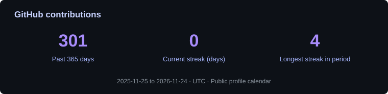
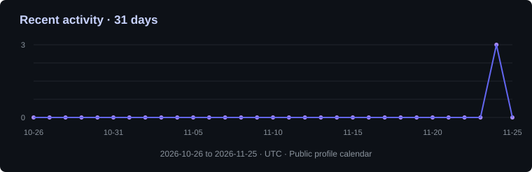

**Cybersecurity · Applied AI · DevOps**

I investigate software vulnerabilities, build AI applications, and automate service deployment.

---

## About Me

I'm a Software Engineering undergraduate at **Soongsil University** and a member of
**ASC**, the university's security academic club.

My experience spans **vulnerability research**, **adversarial machine learning**,
**LLM/RAG applications**, and **CI/CD**. I work on reproducing failures, understanding
their causes, and turning the results into fixes, experiments, and working services.

I've been recognized in **NAVER's Bug Bounty Hall of Fame**, received reporter credit
for **CVE-2026-45729**, and completed **White Hat School's 3rd cohort — Top 20**.

## Focus

| Area | What I work on |
|---|---|
| **Cybersecurity / AppSec** | AFL++ fuzzing, crash triage, root-cause analysis, web security, responsible disclosure |
| **Applied AI / AI Security** | Adversarial ML, computer vision, LLM applications, retrieval-augmented generation, evaluation |
| **DevOps / Service Delivery** | GitHub Actions CI/CD, AWS EC2, Docker, reverse-proxy logging, deployment troubleshooting |

## Featured Work

### [ThorVG — CVE-2026-45729](https://github.com/thorvg/thorvg/security/advisories/GHSA-f863-8ghq-7h64)

Found a **NULL pointer dereference** in ThorVG's SVG loading path through **AFL++**
fuzzing with SVG-aware input generation. Minimized the crashing input to six bytes,
analyzed the failure under **AddressSanitizer**, and reported it through responsible
disclosure. The issue was fixed in **ThorVG 1.0.5**.

**Focus:** Vulnerability research · Fuzzing · Crash analysis · Coordinated disclosure

### [StealthBreaker — Adversarial ML & Computer Vision](https://github.com/yeahhbean/StealthBreaker)

Reproduced **adversarial patch attacks against YOLOv5 person detection** and compared
defenses including **randomized smoothing** and weighted filter combinations.
Used frequency-based experiments to investigate unexpected attack behavior and checked
how results changed under different image conditions.

**Focus:** Python · PyTorch · YOLOv5 · Adversarial robustness · Experimental evaluation

### SSUpervisor — LLM/RAG Academic Administration Assistant

Led a team project that helps staff classify student inquiries, retrieve official
documents, and review AI-generated draft answers. The application combines
**PostgreSQL text search**, **bge-m3 semantic retrieval**, and local **Qwen models via
Ollama**, with staff review before a final answer.

Compared classification failures across model sizes and added targeted server-side
rules with recorded correction reasons. Also ran the application, database, and local
model on a desktop server for testing and demonstration.

**Focus:** LLM applications · RAG · Hybrid retrieval · Evaluation · Human review

**Recognition:** Top Excellence Award (최우수상), Soongsil AI Work Innovation Challenge (team award, 2026).

### Hackahoy — Security Education Platform & CI/CD

Led a **five-person capstone team** building a web security learning platform with an
AI tutor. My work covered the **Next.js frontend**, **OpenResty/Nginx + Lua HTTP log
collection**, web challenges, and integration of the team's services.

To make service integration and deployment repeatable, I configured **GitHub Actions
CI/CD** and **AWS EC2** deployment, with build and restart steps for **PM2 and Docker**
services. Diagnosed a deployment script that replaced itself while running and skipped
later build/restart steps; fixed the execution flow and checked it with a minimal
reproduction.

**Focus:** Service integration · CI/CD · GitHub Actions · AWS EC2 · Docker · Deployment verification

More public work: [LLM-in-the-loop project](https://github.com/yeahhbean/llm_intheloop)
· [Laravel CVE reproduction](https://github.com/yeahhbean/Laravel-CVE-2018-15133)
· [All repositories](https://github.com/yeahhbean?tab=repositories)

## Tech Stack

| Area | Tools and technologies used in my projects |
|---|---|
| **Languages & Applications** | Python · C · JavaScript · TypeScript · Bash · Next.js |
| **Security** | AFL++ · AddressSanitizer · Frida · OpenResty / Lua |
| **AI & Data** | PyTorch · YOLOv5 · Ollama / Qwen · PostgreSQL · bge-m3 |
| **DevOps** | GitHub Actions · AWS EC2 · Docker · Linux · Nginx · PM2 |

## Selected recognition

- **NAVER Bug Bounty Hall of Fame** — acknowledged vulnerability reports
- **White Hat School, 3rd cohort — Top 20**
- **SSUpervisor — Top Excellence Award (최우수상)**, Soongsil AI Work Innovation Challenge, 2026 (team award)
- **Hackahoy — Encouragement Award**, 16th Soongsil Capstone Design Competition, 2026
- **뚜도둑 — Grand Prize**, department-level Creative Engineering Design Competition, 2023

---

## GitHub Analytics

  

Daily snapshot of the publicly visible GitHub contribution calendar. See the dates on each card for freshness.

  

<!-- profile -->
